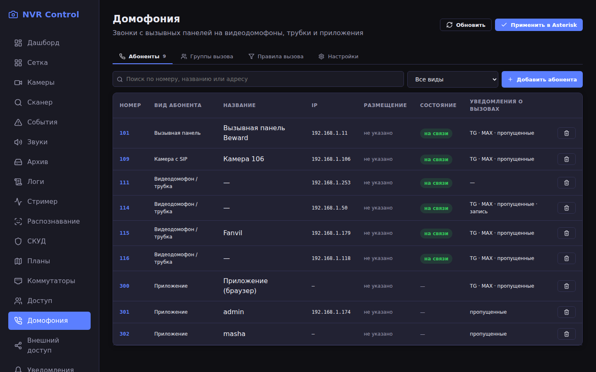
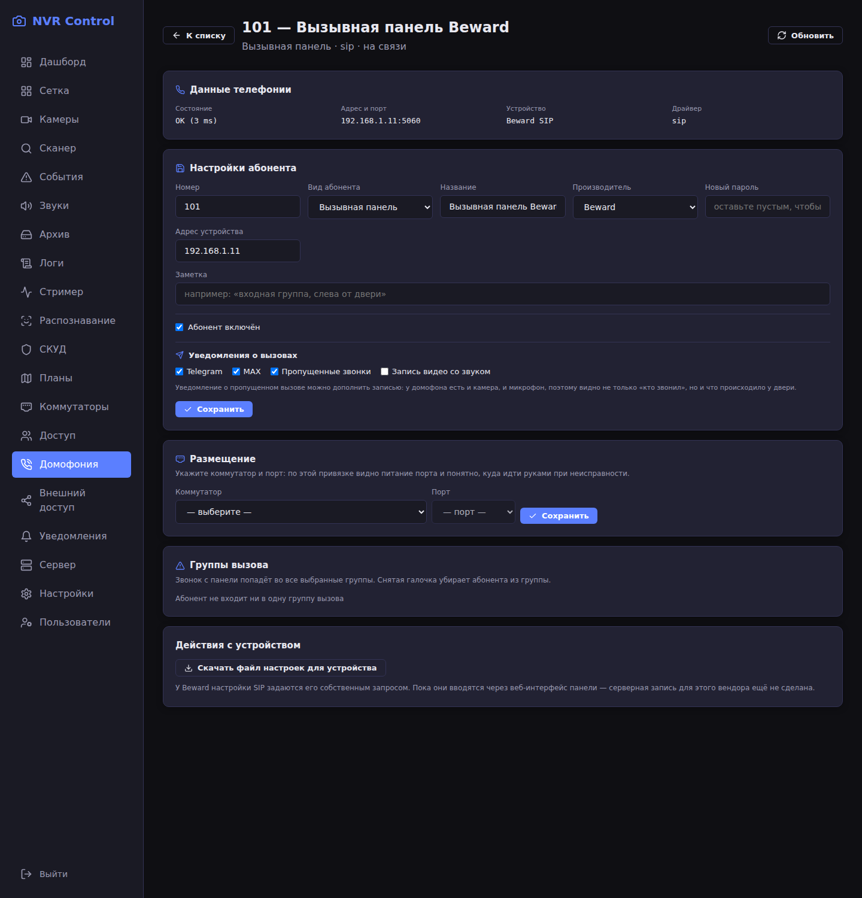
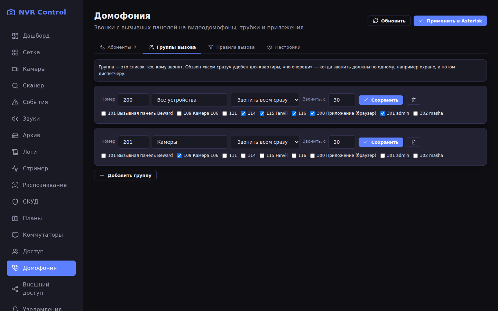
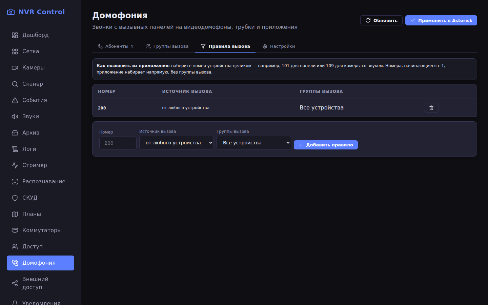
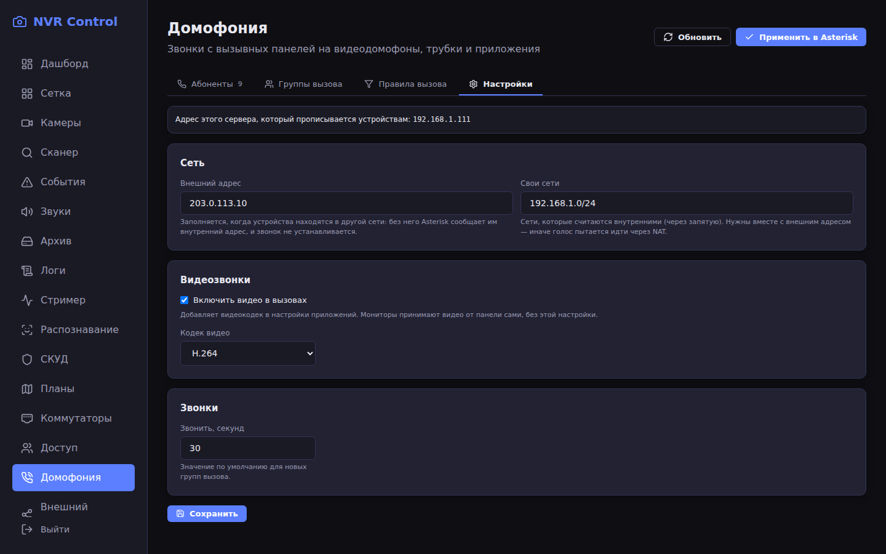

# Домофония (SIP-звонки)

Домофония в NVR — это свой телефонный сервер на базе **Asterisk**: вызывные
панели, видеодомофоны, трубки и приложения (телефон, браузер, десктоп) звонят
друг другу и в группы вызова. Отдельный сервис не нужен — Asterisk поднимается
профилем `sip` в том же `docker-compose.yml`.

Версия станции — **Asterisk 20 (LTS)**, драйвер SIP один: `chan_pjsip`. Старый
`chan_sip` убран целиком, и вместе с ним исчезла привязка к 18-й ветке, где
устройства и приложения обслуживались разными драйверами.



## Как это устроено

| Кто | Драйвер Asterisk | Почему так |
|---|---|---|
| Панели, видеодомофоны, трубки, камеры с SIP | `chan_pjsip` (`pjsip.conf`, UDP-транспорт на 5060) | Изначально выбрали старый `chan_sip`: новый драйвер работал с панелями некорректно. После обновления прошивок панелей (13.10.2026) это перестало быть правдой, и старый драйвер убран целиком: он помечен deprecated и удалён начиная с 20-й ветки Asterisk, а два драйвера означали две ветки настроек и два способа смотреть состояние. Переход — `plans/pjsip-realtime-migration.md` |
| Приложения: браузер, мобильное, десктоп | `chan_pjsip` (`pjsip.conf`, WebSocket на 8088) | Только он умеет SIP over WebSocket, без которого WebRTC-приложению не подключиться |

Драйвер SIP один, поэтому порт тоже один — **5060**: устройства остались
на том же адресе сервера, что и раньше, и после отказа от старого драйвера
их не пришлось перенастраивать.

### Где живут настройки

Настройки абонентов и правила вызова станция читает **из нашей базы** (Asterisk
Realtime), а не из файлов конфигурации:

| Что | Где | Кто пишет |
|---|---|---|
| Абоненты: панели, мониторы, трубки, приложения | таблицы `ps_endpoints`, `ps_auths`, `ps_aors` | сервер при сохранении настроек домофонии |
| Текущие регистрации устройств | таблица `ps_contacts` | сам Asterisk |
| Правила вызова: номера групп и «кому звоним» | таблица `extensions` | сервер при правке групп и правил |
| Транспорты, диапазон портов разговора | `accounts/pjsip_transport.conf`, `accounts/rtp_settings.conf` | сервер |

Причина простая: правка абонента или группы действует **сразу**. С файлами
сервер пересобирал конфигурацию и перезагружал её целиком — а перезагрузка
модуля SIP рвёт соединения приложений, то есть разговор, который идёт в этот
момент, терял линию. Теперь перезагрузки нет вовсе.

Два следствия, которые замечаешь в работе:

- регистрации устройств **переживают перезапуск станции**: они лежат в базе, и
  станция поднимает их обратно, не дожидаясь, пока устройство зарегистрируется
  заново (раньше после каждого перезапуска все устройства были «не на связи»);
- правила вызова ищутся не в файлах: если нужно посмотреть, что станция
  выполнит при вызове группы, смотрите таблицу, а не `extensions.conf`. Там
  только каркас и строки `switch => Realtime/…@extensions`.

### Нумерация

| Диапазон | Кому |
|---|---|
| `1XX` — `101`, `109`, `114`… | устройства: панели, камеры со звуком, видеодомофоны, трубки |
| `2XX` — `200`, `201`… | группы вызова: номер группы набирают, чтобы позвать всех её участников |
| `3XX` — `301`, `302`… | приложения: каждому пользователю сервера выдаётся своя линия |

Номер **закрепляется за учётной записью** и больше не меняется: он прописан
в телефоне сотрудника, и смена номера означает, что вызовы уходят не туда.
Закрепление хранится отдельно от самой линии (`user_sip_numbers`), поэтому
номер переживает и правку карточки абонента, и пересоздание линии.
Номера выданных линий переносятся в закрепление миграцией автоматически.
Поменять номер вручную можно, но придётся заново настроить телефон:
он регистрируется на номер, а не на имя.

Диапазоны разделены не для красоты: по номеру сразу видно, кто звонит —
устройство или приложение.

## Включение телефонии

```bash
# в каталоге проекта
docker compose --profile sip up -d
```

При первом запуске стоит задать пароль AMI (через него сервер перечитывает
конфигурацию): переменная `ASTERISK_AMI_SECRET` в `.env`. Порт WebSocket тоже
настраивается переменной — `ASTERISK_WS_PORT` (по умолчанию `8088`).

## Настройка в интерфейсе

Раздел **Домофония** состоит из четырёх вкладок.

### 1. Абоненты

Кто звонит и кому звонят. Кнопка «Добавить абонента»: номер, вид (панель,
камера, видеодомофон, приложение), название, пароль. Вид определяет контекст
вызова и набор настроек: у устройства — `from-devices`, у приложения —
`from-apps`. Ошибиться здесь значит получить неработающий звонок.

У каждого абонента есть карточка (`Домофония → Абоненты → номер`):



- **Данные телефонии** — то, что видит Asterisk: состояние (`OK (1 ms)`), адрес
  с портом, модель устройства. Это данные самой станции, а не нашей
  базы: по ним видно, то ли устройство стоит на этом номере.
- **Настройки** — номер, вид, название, пароль, производитель, адрес
  устройства, заметка, включение и уведомления о вызовах.
- **Размещение** — коммутатор и порт: по ним понятно, где искать устройство и
  что с его питанием.
- **Группы вызова** — в каких группах состоит абонент.
- **Действия с устройством** — зависят от производителя: у Fanvil можно
  скачать файл настроек линии или записать его в трубку по сети; у Dahua,
  OpenIPC и Beward показано, где править SIP в самом устройстве.

Адрес устройства сервер подставляет сам из регистрации Asterisk — вписывать его
руками нужно только если устройство молчит.

### 2. Группы вызова

Кому звонить, когда набран номер группы.



У группы есть **номер** (то, что набирают с устройства), название, стратегия
обзвона (всем сразу или по очереди) и состав — галочками. Группа без номера
работает только через правило вызова, и об этом написано прямо в карточке.

### 3. Правила вызова

Какое набранное сочетание клавиш в какую группу звонит. Источник можно не
указывать — тогда правило работает для всех. Нужны там, где номер группы не
подходит: например, панель звонит «всем» по своей кнопке вызова.



### 4. Настройки



- **Внешний адрес** — адрес сервера, который прописывается устройствам, когда
  они находятся в другой сети (за роутером). Для работы только внутри дома не
  нужен и даже вреден.
- **Свои сети** — какие сети считать внутренними. Указывать **сетью**, а не
  одним адресом: `192.168.1.0/24`. Если указать `192.168.1.111`, станция
  посчитает «своим» только сам сервер и всем остальным подставит внешний
  адрес — звонки будут работать нестабильно, а видео может не идти вовсе.
- **Видеозвонки** — разрешить видео и выбрать кодек. Для устройств подходит
  `h264`: они его отдают; `vp8`/`vp9` понимают только приложения.
- **STUN-сервер** — через него станция узнаёт свой внешний адрес и предлагает
  его телефону. Нужен для звонков из мобильной сети; если приложениями
  пользуются только дома, поле можно оставить пустым.
- **Порты разговора** — диапазон портов, по которым идёт звук и видео. Именно
  его пробрасывают на роутере для внешних звонков (по умолчанию
  `10000-10100`).
- **Сервер TURN** и его порты — ретранслятор для звонков из чужих сетей.
  Подробнее: «Чужие сети: TURN-релей» ниже. Пустое поле означает, что TURN не
  используется.
- **Логин и пароль TURN** — учётные данные ретранслятора, те же, что в `.env`.
  Их получает приложение вместе с реквизитами линии.
- **Домен для сертификата**, **токен DuckDNS** и **почта** — для защищённого
  пути. Там же кнопка **«Выпустить сертификат»**, а рядом — до какого числа
  действует уже выпущенный. Подробнее: «Чужие сети: TURN-релей» ниже.
- **Звонить, с** — сколько секунд звонить, прежде чем считать вызов
  пропущенным.

Эти значения сервер сам вставляет в конфигурацию Asterisk — файлы править
руками не нужно, а изменение портов действует сразу, без перезапуска станции.

После правок нажмите **«Применить в Asterisk»** — станция перечитает файлы.

## Пропущенные вызовы: уведомления и журнал

Сервер слушает звонки прямо в Asterisk и знает, чем закончился каждый
вызов. О неудачных он сообщает в Telegram и MAX, а все вызовы пишет
в журнал — вкладка **«Журнал звонков»** на странице «Домофония».

**Что считается пропущенным.** Неудачная попытка дозвона: не ответили,
занято или устройство недоступно. Если звонок шёл в группу из трёх трубок
и никто не снял, сообщений будет три — по одному на каждую попытку.

**Куда сообщать.** В карточке абонента, **с которого звонят** (обычно это
вызывная панель), есть галочки: «Пропущенные звонки», «Telegram», «MAX».
То есть у панели у калитки может быть свой чат, а у трубки в офисе — свой.
Каналы Telegram и MAX должны быть включены в настройках уведомлений.

**Запись вызова.** Галочка «Запись вызова» записывает момент звонка и то,
что происходило после него, и прикладывает видео **со звуком** к сообщению.
Нужно, чтобы у абонента была указана привязанная камера (карточка абонента
→ камера устройства).

Звук пишется вместе с картинкой: по немому клипу не понять, что человек
говорил у двери. Панели и камеры отдают звук в G.711, для которого в MP4
нет тега, поэтому при записи он перекодируется в AAC — такой файл
проигрывают и браузер, и Telegram. У камер без микрофона клип остаётся без
звуковой дорожки, и это нормально.

**Журнал.** Вкладка показывает список вызовов: когда, кто звонил, куда,
чем закончилось и сколько длился разговор. По умолчанию видны только
неудачные — это самый частый вопрос; переключателем можно показать все.

**Что нужно на сервере.** Пользователю AMI `nvr` в `manager.conf` нужна
категория `call`: без неё сервер видит состав абонентов, но не сами
звонки. Установщик (`install.sh --sip`) пишет её сам; на уже настроенной
установке добавьте её в строку `read` и выполните
`asterisk -rx "manager reload"`.

## Абоненты: как заводить устройства

### Fanvil (трубки i501 и подобные)

Настраиваются **по сети прямо из интерфейса**: в карточке абонента укажите
логин и пароль веб-интерфейса трубки и нажмите «Записать в устройство». Сервер
возьмёт номер и пароль из базы и запишет их в трубку. Проверено на живых
аппаратах: настройки применяются и читаются обратно.

### Dahua (видеодомофоны TI-3430WP и подобные)

Веб-интерфейс закрыт, автонастройка невозможна: SIP задаётся **в меню самого
монитора**. В карточке абонента сервер честно об этом скажет.

### OpenIPC / Majestic (камеры со звуком)

Настройки SIP живут в разделе `sip` конфигурации Majestic и применяются
**только после перезагрузки** камеры. Камера в звонке отдаёт только звук:
видео у неё смотрится отдельным потоком в разделе «Камеры».

### Beward (вызывные панели)

Настраиваются CGI-запросом панели (`sip_cgi`). Важно: панель открывает дверь
по коду, переданному в сообщении **SIP INFO**, поэтому в конфигурации
устройства ей ставится `dtmfmode=info` — это делает сервер автоматически для
производителя `beward`.

## Приложения: звонки с телефона

Любому пользователю сервера линия выдаётся **автоматически**: номер из
свободных `3XX`, свой пароль (не пароль от входа в систему). Мобильное
приложение забирает реквизиты само при входе — настраивать ничего не нужно.

Что умеет приложение:

- исходящий звонок на устройство, группу или другого пользователя;
- приём вызова, в том числе **при заблокированном экране**;
- видео, если его отдаёт вызывающее устройство;
- громкая связь, отключение микрофона;
- кнопка **«Открыть дверь»** — отправляет код `123#` на панель (и клавиатура
  для ручного набора любого кода).

Чтобы вызовы доходили в фоне, приложение просит разрешение «работать без
ограничений» и держит постоянное уведомление. На телефонах TECNO, Xiaomi,
Huawei и подобных дополнительно нужно:

1. разрешить **автозапуск** приложения (в «Диспетчере телефона»/«Безопасности»);
2. в разделе батареи выбрать **без ограничений** для приложения;
3. **закрепить** приложение в списке недавних задач (значок замка).

Без этого прошивка «замораживает» приложение через несколько секунд после
ухода в фон — вызов придёт только после разблокировки. Подробности в
[MOBILE.md](MOBILE.md).

### Звонок с телефона на телефон

Каждый пользователь получает **свой** номер, поэтому телефоны звонят друг
другу напрямую: наберите номер коллеги (`302`) или найдите его в списке
абонентов на экране «Звонки». Правило `_3XX` в контексте `from-apps`
разрешает такой набор; без него второе приложение в сети как будто
отсутствует.

Важно: на каждом телефоне нужна **своя учётная запись**. Линия выдаётся
пользователю, а не устройству, и если войти одинаково на двух телефонах,
оба получат один номер — входящие будут «прыгать» между аппаратами, а
звонок себе самому завершится ничем.

Для видео при ответе нужно выданное разрешение камеры. Если его нет,
приложение отвечает только со звуком — так и задумано (человека у двери
надо слышать даже без картинки).

## Порты

### Внутренняя сеть (между сервером и устройствами/телефонами)

| Порт | Протокол | Назначение |
|---|---|---|
| `5060` | UDP | SIP для устройств (панели, трубки, видеодомофоны) |
| `8088` | TCP | SIP over WebSocket для приложений + HTTP-сервер Asterisk |
| `10000–10100` | UDP | голос и видео звонка (RTP) |
| `3001` | TCP | веб-интерфейс (он же проксирует `/api/`, `/mse/`, `/ws`) |
| `8080` | TCP | REST API (им пользуется мобильное приложение) |
| `8555` | TCP+UDP | медиа WebRTC для live-просмотра камер |
| `9784` | TCP | внешний RTSP-доступ к камерам |

### Работа из внешней сети (проброс на роутере)

Если приложением пользуются **не только внутри дома**, на роутере
пробрасываются:

| Наружу | Внутренний адрес | Зачем |
|---|---|---|
| `5060/udp` | `сервер:5060` | чтобы внешние SIP-устройства могли зарегистрироваться |
| `8088/tcp` | `сервер:8088` | WebSocket приложений: без него телефон не зарегистрируется |
| `10000–10100/udp` | `сервер:10000–10100` | голос и видео во время звонка |
| `3001/tcp` | `сервер:3001` | веб-интерфейс |
| `8080/tcp` | `сервер:8080` | API для мобильного приложения |
| `8555/tcp+udp` | `сервер:8555` | видео просмотра камер (WebRTC) |
| `3478/udp+tcp` | `сервер:3478` | TURN: ретрансляция голоса и видео в чужих сетях |
| `5349/tcp` | `сервер:5349` | TURN поверх TLS (нужен настоящий сертификат: домен + Let's Encrypt) |
| `443/tcp` | `сервер:443` | веб-интерфейс по HTTPS (профиль `tls`), а не TURN — см. пояснение ниже |
| `49160–49260/udp` | `сервер:49160–49260` | порты ретрансляции TURN (по одному на разговор в каждую сторону) |

После этого в **Домофония → Настройки** укажите:

- «Внешний адрес» — публичный адрес или домен (например, `nvr.example.ru`);
- «Свои сети» — локальную сеть **сетью**: `192.168.1.0/24`.

Так локальные устройства получат локальный адрес, а внешние — внешний; без
разделения голос пытается идти через NAT и связь рвётся.

### Что ещё нужно для звонков из мобильной сети

Одного проброса портов мало: приложение зарегистрируется, звонок пройдёт, а
звука и видео не будет. Проверено на живом — причин три, и все про адреса,
которые станция сообщает телефону.

- **Внешний адрес в SDP.** Приложениям он подставляется из настроек
  телефонии («Внешний адрес»), поле `media_address`. Без него телефону
  уходит локальный `192.168.1.x`, и он шлёт медиа в недостижимую сеть.
- **STUN.** Через него станция узнаёт свой внешний адрес и добавляет
  внешний ICE-кандидат. Адрес задаётся в настройках телефонии («STUN-сервер»),
  по умолчанию — `stun.sipnet.ru:3478`. Запросы к `stun.l.google.com`
  уходили без ответа, и внешний кандидат так и не появлялся.
- **Симметричный RTP** (`rtp_symmetric`, задаётся в конфигурации абонентов).
  Станция запоминает адрес телефона по первому полученному пакету. Без
  этого она адресует звук на внутренний адрес оператора (`100.122.x.x`),
  откуда пакеты не доходят.

Отключать ICE у станции нельзя: приложение (WebRTC) без него обрывает вызов
с ошибкой «rtc error» — проверено.

### Чужие сети: TURN-релей

Проброса портов и STUN хватает не всегда. Проверено на живом сервере: из
мобильной сети и из домашней сети оператора звонки шли, а из чужого Wi-Fi
приложение регистрировалось, но вызов не соединялся.

Причина в том, что путь для медиа ищет сам телефон. Сигнализация идёт по
WebSocket (TCP) и проходит везде, а голос — по UDP; чужая сеть либо
закрывает UDP наружу, либо её NAT устроен так, что ответные пакеты приходят
не туда. Снаружи это выглядит как «вызов соединяется, но звука нет».

Лечится ретранслятором TURN: медиа идёт не напрямую, а через сервер, и
работает даже там, где прямой путь невозможен. Поднимается на том же сервере
отдельным контейнером (профиль `turn`, в обычном `docker compose up` не
попадает):

```sh
# в .env, рядом с остальными настройками
echo 'TURN_USER=nvr' >> .env
echo 'TURN_PASSWORD=<пароль>' >> .env
echo 'TURN_REALM=nvr' >> .env
echo 'TURN_EXTERNAL_IP=<внешний адрес сервера>' >> .env

docker compose -f docker-compose.yml -f docker-compose.turn.yml --profile turn up -d turn
```

Затем на странице **Домофония → Настройки**, в блоке «Медиа разговора»,
заполните «Сервер TURN», его порты и пару «логин/пароль» — значения должны
совпадать с `.env`. Приложение получает их от сервера вместе со своей линией
(`ice_servers` в `GET /sip/my-line`), поэтому при смене пароля его не нужно
пересобирать.

Что обязательно (проверено на живом сервере):

* контейнер TURN работает **в host-сети**: с bridge-сетью он сообщает
  клиенту адрес из внутренней сети Docker, и медиа уходит в никуда;
* `TURN_EXTERNAL_IP` заполнен, когда сервер за NAT — иначе клиент получает
  внутренний адрес;
* на роутере открыты TURN-порты (см. пример ниже), иначе STUN даже не
  отвечает с внешнего адреса;
* логин и пароль заполнены обязательно: открытый ретранслятор забьют чужим
  трафиком, поэтому сервер не даёт сохранить TURN без учётных данных.

Проверить, отвечает ли ретранслятор снаружи:

```sh
# с любой внешней машины
turnutils_stunclient -p 3478 <внешний адрес сервера>
# ожидаемый ответ: IPv4. UDP reflexive addr: <внешний адрес>:<порт>
```

А посмотреть, пользовались ли им, можно в журнале контейнера:
`docker logs gigacode-turn-1` — во время звонка из чужой сети там появляются
выделенные адреса ретрансляции.

Про TLS. Сертификат берётся из каталога `turn/certs` (`turn.crt` и
`turn.key`, в репозиторий не попадают) — у каждой установки он свой. С
самоподписанным сертификатом клиент отвергает путь `turns:`, поэтому нужен
настоящий: бесплатного домена на DuckDNS достаточно (см. ниже). Пока
сертификата нет, работает путь TURN по TCP на `3478` — для чужих сетей его
хватает почти всегда.

#### Сертификат: выпуск и продление

Всё делается в интерфейсе: **Домофония → Настройки → «Сертификат для TURN»**.
Укажите домен, токен DuckDNS и почту, сохраните и нажмите **«Выпустить
сертификат»**. Рядом видно, до какого числа он действует и сколько дней
осталось, а если выпуск не удался — причину отказа: она сохраняется, поэтому
видна и после перезагрузки страницы.

Домен и адрес TURN должны совпадать: сертификат выписан на имя, и телефон
сверяет с ним то, к чему подключается. Если оставить адрес TURN пустым, сервер
подставит в него домен сам.

Токен берётся со страницы вашего аккаунта на `duckdns.org`. По нему сервер
создаёт проверочную TXT-запись, поэтому пробрасывать порт 80 для выпуска не
нужно. На сервере токен оказывается в файле `turn/.duckdns-token` (права
`600`) — оттуда его берёт продление по расписанию, которому база недоступна.

Выпуск выполняет служба `nvr-agent` на хосте: контейнеру бэкенда для этого
нужны права, которых у него быть не должно (запустить acme.sh, записать файлы
в каталог установки и перезапустить coturn). Если служба не установлена или
остановлена, кнопка неактивна и рядом написано, что проверить.

Продление ставится один раз:

```sh
scripts/turn-cert.sh cron    # ежедневная проверка: продлевает, когда пора
```

То же самое можно сделать из командной строки:

```sh
scripts/turn-cert.sh check   # проверить токен и имя
scripts/turn-cert.sh issue   # выпустить сертификат
```

Скрипт сам кладёт файлы в `turn/certs` с нужными правами и перезапускает
coturn — но только когда сертификат действительно обновился: лишний
перезапуск обрывал бы разговоры, которые идут в этот момент.

Права здесь не мелочь. coturn работает от пользователя `nobody`, и ключ с
правами `600` и владельцем `root` он просто не видит: TLS молча не
поднимается, а в журнале остаётся «private key file is not set properly».

Про порт 443. Часть сетей разрешает только защищённый трафик и только на
привычные порты, поэтому раньше `443/tcp` пробрасывался на порт TURN. Теперь
этот порт отдан веб-интерфейсу: HTTPS в браузере важнее (без него Chrome не
даёт микрофон, и разговор через камеру в панели невозможен), а TURN остаётся
на `3478` (udp и tcp) и `5349`. В сетях, где открыт только 443, ретрансляция
пойдёт по TCP на `3478` — обычно этого хватает.

Сам coturn порт `443` занять не может: непривилегированный процесс не берёт
порт ниже `1024`, а `--alt-tls-listening-port` работает только в паре с
`--alt-listening-port`. Поэтому на `443` стоит прокси с тем же сертификатом
(профиль `tls`), а проброс ведёт на него:

```sh
uci add firewall redirect
uci set firewall.@redirect[-1].name='nvr-web-tls'
uci set firewall.@redirect[-1].target='DNAT'
uci set firewall.@redirect[-1].src='wan'
uci set firewall.@redirect[-1].src_dport='443'
uci set firewall.@redirect[-1].dest='lan'
uci set firewall.@redirect[-1].dest_ip='<адрес сервера>'
uci set firewall.@redirect[-1].dest_port='443'
uci set firewall.@redirect[-1].proto='tcp'
```

На роутере порт `443` может быть занят своим веб-интерфейсом (`uhttpd`):
правило перехватит только подключения снаружи, доступ изнутри сети
останется как был.

Домен в настройках домофонии должен совпадать с именем в сертификате —
иначе телефон отвергнет соединение: сертификат выписан на одно имя, а
подключается клиент к другому. По той же причине домен стоит указать и в
поле «Внешний адрес»: тогда смена адреса провайдером не потребует правки
настроек — адрес обновит роутер, а имя останется тем же.

Пример проброса на OpenWrt (порты 8088 и медиа; правило `nvr` и остальные
пробросы установки при этом не трогаются):

```sh
uci add firewall redirect
uci set firewall.@redirect[-1].name='nvr-ws'
uci set firewall.@redirect[-1].target='DNAT'
uci set firewall.@redirect[-1].src='wan'
uci set firewall.@redirect[-1].src_dport='8088'
uci set firewall.@redirect[-1].dest='lan'
uci set firewall.@redirect[-1].dest_ip='<адрес сервера>'
uci set firewall.@redirect[-1].dest_port='8088'
uci set firewall.@redirect[-1].proto='tcp'

uci add firewall redirect
uci set firewall.@redirect[-1].name='nvr-rtp'
uci set firewall.@redirect[-1].target='DNAT'
uci set firewall.@redirect[-1].src='wan'
uci set firewall.@redirect[-1].src_dport='10000-10100'
uci set firewall.@redirect[-1].dest='lan'
uci set firewall.@redirect[-1].dest_ip='<адрес сервера>'
uci set firewall.@redirect[-1].dest_port='10000-10100'
uci set firewall.@redirect[-1].proto='udp'

# TURN: порт сигнализации ретранслятора (udp и tcp), TLS и диапазон
# ретрансляции медиа. Без этих правил звонки из чужих сетей не соединяются.
add_turn() {
  uci add firewall redirect
  uci set firewall.@redirect[-1].name="$1"
  uci set firewall.@redirect[-1].target='DNAT'
  uci set firewall.@redirect[-1].src='wan'
  uci set firewall.@redirect[-1].src_dport="$2"
  uci set firewall.@redirect[-1].dest='lan'
  uci set firewall.@redirect[-1].dest_ip='<адрес сервера>'
  uci set firewall.@redirect[-1].dest_port="$2"
  uci set firewall.@redirect[-1].proto="$3"
}
add_turn nvr-turn-udp 3478 udp
add_turn nvr-turn-tcp 3478 tcp
add_turn nvr-turn-tls 5349 tcp
add_turn nvr-turn-relay 49160-49260 udp

uci commit firewall
/etc/init.d/firewall reload
```

Проверить, что медиа пошло, можно по счётчику правила на роутере:
`nft list ruleset | grep 'udp dport 10000-10100'` — он должен расти во время
разговора.

Настраивать ничего в файлах не нужно: внешний адрес, свои сети, адрес STUN и
диапазон портов задаются на странице **Домофония → Настройки**, а сервер
собирает из них конфигурацию Asterisk.

Проверить, что наружу всё доступно, можно с телефона в мобильной сети: войти в
приложение и позвонить на панель. Если не выходит — почти всегда закрыт
`8088/tcp` (нет регистрации) или диапазон RTP (звонок идёт, но нет звука).

## Диагностика

Быстрая проверка линии приложения без телефона:

```bash
node scripts/check-sip-line.js 301 ПАРОЛЬ_ЛИНИИ
# → РЕГИСТРАЦИЯ: линия 301 на связи (ws://192.168.1.111:8088/ws)
```

Полезные команды станции:

```bash
docker exec gigacode-asterisk-1 asterisk -rx "pjsip show contacts"   # кто на связи
 docker exec gigacode-asterisk-1 asterisk -rx "pjsip show endpoints"  # все абоненты
docker exec gigacode-asterisk-1 asterisk -rx "dialplan show from-devices"
docker exec gigacode-asterisk-1 asterisk -rx "dialplan show from-apps"
```

### Частые случаи

| Симптом | Причина | Что делать |
|---|---|---|
| Звонок срывается сразу после набора, в логе `No format found to offer` | у приложения разрешён кодек, которого нет у устройства (например `opus`) | в настройках оставить `alaw,ulaw` для голоса; сервер ставит их сам |
| Нет видео с панели на телефон | у устройств запрещено видео на станции | в настройках телефонии должны быть включены видеозвонки; тогда сервер записывает в `ps_endpoints.allow` список с видеокодеком (например `alaw,ulaw,h264`). Руками таблицу править бессмысленно — её перезаписывает сервер |
| Абонент заведён в интерфейсе, но станция его не видит; команды `pjsip show` вообще нет | `res_pjsip` отказался загружаться: механизм realtime оказался не готов | `res_config_pgsql.so` и `res_sorcery_realtime.so` обязаны загружаться РАНЬШЕ pjsip — в `asterisk/config/modules.conf` они в `preload`; в журнале это `Wizard 'realtime' could not be applied` |
| После перезапуска станции все устройства «не на связи» | регистрации не сохраняются в базе | в `sorcery.conf` должна быть строка `contact=realtime,ps_contacts` именно в секции `[res_pjsip]` (со `[res_pjsip_registrar]` регистрации работают, но в базу не пишутся); проверить: `SELECT count(*) FROM ps_contacts` |
| Вызов в группу уходит в Congestion, хотя правило есть | шаблон в `extensions.conf` перехватил вызов раньше базы | правила групп и отказ на неизвестный номер живут в таблице `extensions`; шаблонов в файле быть не должно |
| Абонент молча пропал из регистраций | устройство применило настройки SIP только после перезагрузки | камеры Majestic меняют SIP-настройки только после перезагрузки — если порт сервера в устройстве меняли, перезагрузить устройство |
| В логе `Contents of … are invalid` | файл настроек недоступен Asterisk на чтение | права на `asterisk/config/accounts/*.conf` и на `res_pgsql.conf` должны быть `644`; сервер выставляет их сам |
| Устройство видно в `pjsip show endpoints`, но `Unavailable` | устройство ещё не зарегистрировалось после перезапуска станции | подождать цикл регистрации (до 2 минут) или перезагрузить устройство; в `pjsip show contacts` его не будет |
| Телефон «постоянно переподключается» | пропал WS-транспорт при пересборке конфигурации | у `[transport-ws]` в `pjsip.conf` обязателен `bind=0.0.0.0:8088` |
| Код открытия двери не срабатывает | DTMF идёт как SIP INFO, а станция его не принимала | у приложений `dtmf_mode=auto_info`, у панели Beward `dtmfmode=info` |
| Вызов не приходит при заблокированном экране | прошивка замораживает приложение | разрешения на автозапуск/батарею (см. выше) и полноэкранное уведомление в приложении |
| Звонок в группу с приложения не проходит, с панели — проходит | правила групп доступны не всем контекстам | в `extensions.conf` строка `switch => Realtime/…@extensions` должна быть и в `[from-devices]`, и в `[from-apps]`; правила при этом лежат в базе (таблица `extensions`) |

| Звонок с приложения в группу обрывается сразу после набора, в логе `Set(CALLLIST=…)` с мусором вместо каналов | в Asterisk `REPLACE()` удаляет **символы**, а не подстроку, и список целей портился | исправлено в генераторе плана (`writeDialplanRule`, перебор `CUT` + `While`); если видите этот симптом — обновите сервер |
| Телефону «звонит» он сам, когда звоните в группу, куда входит ваша линия | звонящий не исключался из списка обзвона | исправлено там же — звонящий вычитается из списка; обновите сервер |
| Односторонний звук с панели | панель рекламирует в SDP внешний адрес, и голос уходит не туда | в генераторе транспорта (`renderPjsipTransport`) должны быть `external_signaling_address`/`external_media_address` и `local_net`; у устройств — `rtp_symmetric=yes`. Кто именно попал в `nat`, задаётся на странице настроек телефонии |
| Вызов обрывается сразу после набора, в логе `486 Busy Here` | устройство отвечает «занято»: на трубке остался незавершённый вызов | перезагрузить трубку (Fanvil i501 отвечает `486`, `Q.850 cause=17`) |
| Нет видео при звонке с телефона на телефон либо картинка только у одного | отвечающему приложению не выдано разрешение камеры | выдать разрешение в настройках системы и позвонить снова |
| Звонок из приложения обрывается через несколько секунд после ответа | приложение вело только одну сессию, и отмена второго вызова сбрасывала разговор | исправлено в приложении: лишний вызов отклоняется, события сверяются со своей сессией |

Больше симптомов — в [TROUBLESHOOTING.md](TROUBLESHOOTING.md).

## Что проверено на живом оборудовании

- **Панель Beward** (`101`) — звонки, DTMF-код открытия двери, видео в звонке
  (в логе станции видно два потока RTP с адреса панели — звук и видео).
- **Видеодомофоны Dahua** (`116`) и **трубки Fanvil** (`114`, `115`) — звонки,
  видео, автонастройка (Fanvil).
- **Камеры OpenIPC / Majestic** (`109`, `192.168.1.106`) — звонок и **видео**: после
  обновления прошивки камера отдаёт картинку по SIP (13.10.2026). В логе станции
  видны два потока с её адреса (`:5004` — звук, `:5006` — видео). Раньше картинки
  не было — это ограничение старой прошивки, а не наша настройка; при переносе
  установки проверять камеру отдельно: у части сборок SIP-модуль только звуковой.
### Предпросмотр и звонок на заблокированный телефон

Две особенности, которые надо знать про приложение на телефоне.

**Предпросмотр.** Станция соединяет медиа сторон только после ответа, поэтому
картинку с панели **до** нажатия «Ответить» обычным способом не получить.
Приложение принимает вызов сразу и молча: на экране появляется «видно гостя ·
микрофон выключен», кнопки «Ответить»/«Отклонить», доступна кнопка «Открыть
дверь». По нажатию «Ответить» включается микрофон. Побочный эффект: панель
считает вызов принятым, поэтому в журнале он будет отмечен как отвеченный, даже
если человек так и не нажал кнопку.

**Заблокированный телефон.** Прошивка замораживает приложение в фоне, и сокет до
станции закрывается: регистрация снимается, линия исчезает из списка доступных.
Когда телефон в блокировке, сервер отправляет push о звонке (нужны настроенные
уведомления Firebase на сервере и разрешение на уведомления на телефоне), а
станция в это время **повторяет набор**: попытка длится обычные 20 секунд, а
повтор происходит только если линии не было вовсе — то есть телефон ещё не
зарегистрировался. Если в группе кроме приложения есть мониторы, они звонят всё
это время как обычно.

Проверено на живом (13.10.2026): звонок с панели доходит до телефона в блокировке,
экран загорается, вызов не обрывается и не повторяется.- **Мобильное приложение** — регистрация по WebSocket, приём вызова в фоне и
  на заблокированном экране, видео, громкая связь, открытие двери по `123#`.
  Проверены звонки телефон — телефон (`301` ↔ `302`) со звуком и видео
  в обе стороны; при исходящем вызове слышны гудки ожидания.
- **Компьютерный софтфон** — работает как обычное устройство (`111`).

## Ограничения

- Asterisk **не перекодирует видео**: картинка идёт «как есть», поэтому кодек
  должен совпадать у обоих концов (`h264` понимают и устройства, и приложения).
- Видео между WebRTC-приложением и обычным SIP-устройством работает не на всех
  прошивках устройств. Если у устройства нет стабильного SIP-видео, картинку из
  звонка можно смотреть отдельным потоком в разделе «Камеры».
- Пропущенные вызовы пока только отмечаются (галочки уведомлений); запись
  видео и отправка сообщения по пропущенному — в планах
  (`plans/sip-intercom-plan.md`).
